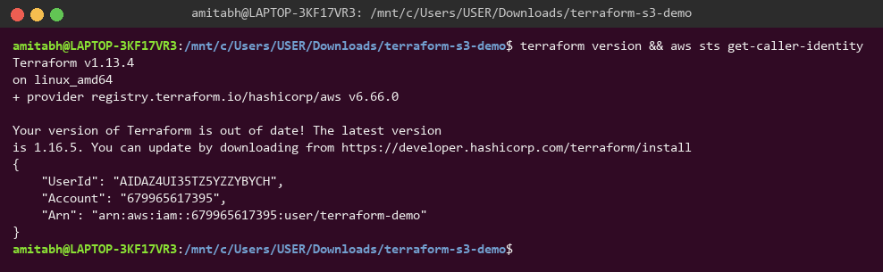
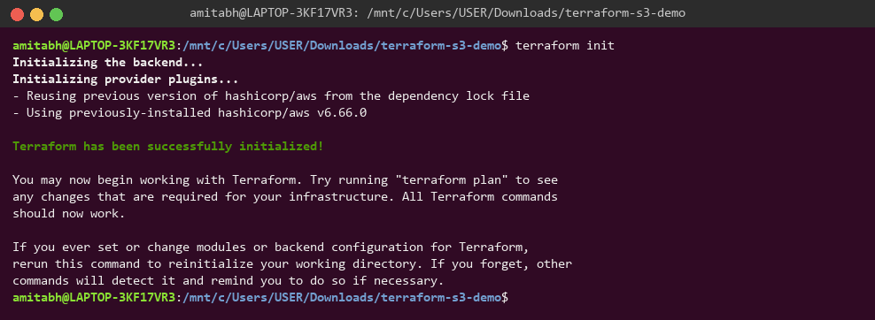
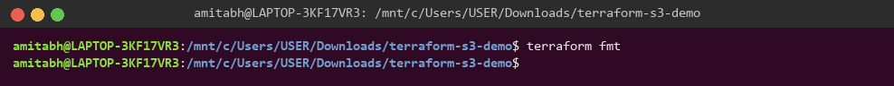
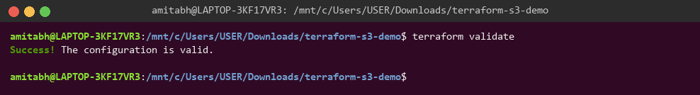
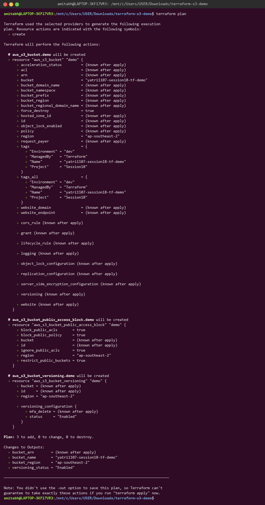
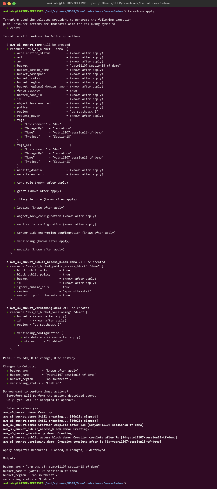
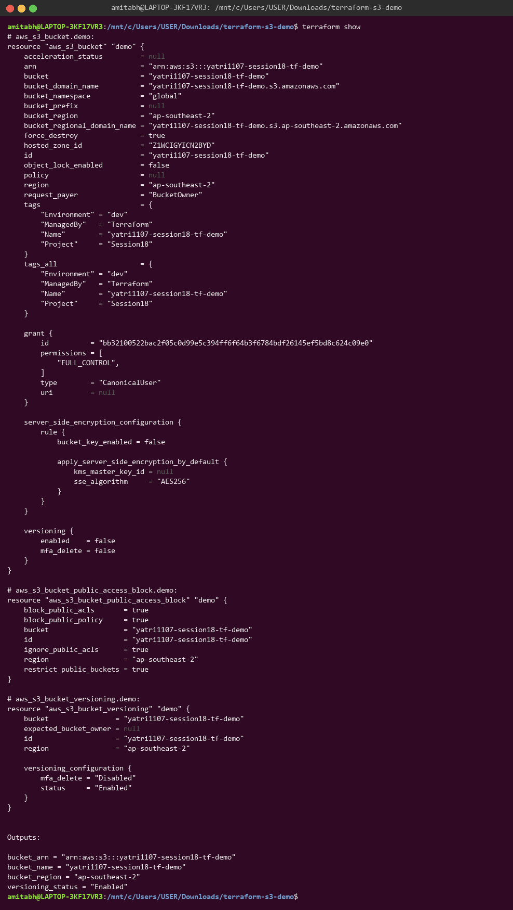
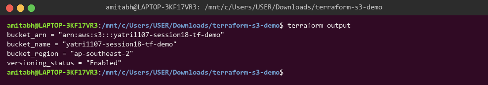
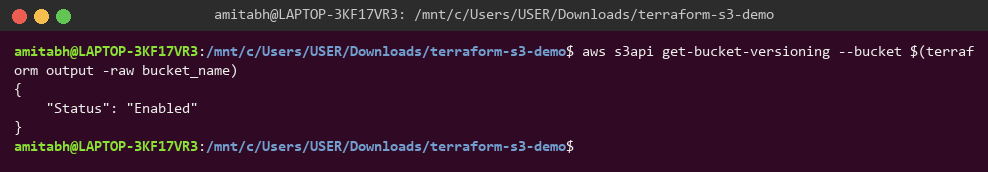
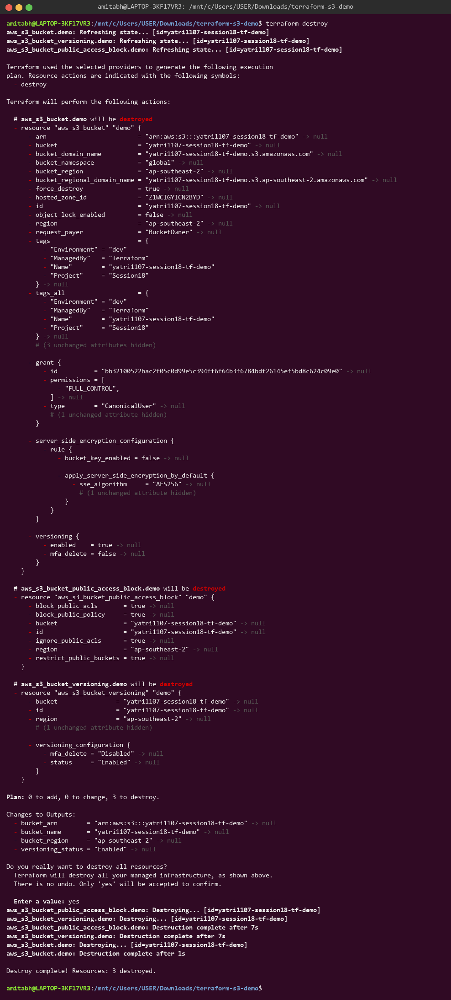

# Session 18 — Submission

## Task 1: Terraform S3 Demo

All commands were run in WSL Ubuntu from `/mnt/c/Users/USER/Downloads/terraform-s3-demo`.

Project files: [main.tf](main.tf) · [variables.tf](variables.tf) · [outputs.tf](outputs.tf) · [provider.tf](provider.tf) · [terraform.tfvars](terraform.tfvars) · [README.md](README.md)

### 0. Prerequisites

Confirm Terraform is installed and the AWS CLI is authenticated.

### 1. terraform init

Initializes the working directory and downloads the AWS provider.

### 2. terraform fmt

Formats all `.tf` files to the canonical style (no output = already formatted).

### 3. terraform validate

Checks the configuration for syntax and internal consistency.

### 4. terraform plan

Previews the resources Terraform will create.

### 5. terraform apply

Creates the S3 bucket, versioning and public access block after confirming with `yes`.

### 6. terraform show

Displays the current state of the managed resources.

### 7. terraform output

Prints the output values defined in `outputs.tf`.

### 8. Verify with AWS CLI

Confirms the bucket exists in AWS with versioning enabled.

### 9. terraform destroy

Deletes all resources managed by this configuration after confirming with `yes`.

## Task 2: AWS Services Research

| # | Service | Notes |
|---|---|---|
| 01 | IAM — Governance | [aws-services/01-iam/README.md](aws-services/01-iam/README.md) |
| 02 | EC2 — Compute | [aws-services/02-ec2/README.md](aws-services/02-ec2/README.md) |
| 03 | S3 — Storage | [aws-services/03-s3/README.md](aws-services/03-s3/README.md) |
| 04 | VPC — Networking | [aws-services/04-vpc/README.md](aws-services/04-vpc/README.md) |
| 05 | DynamoDB & RDS — Databases | [aws-services/05-dynamodb-rds/README.md](aws-services/05-dynamodb-rds/README.md) |
